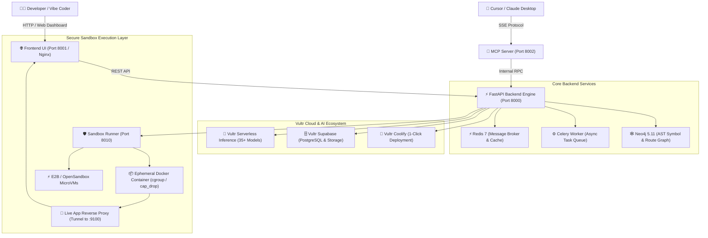

# 🚀 Preflight — Autonomous Code Quality & Shipping Auditor for Vibe Coders

[](LICENSE)
[](docker-compose.yml)
[](https://fastapi.tiangolo.com)
[](https://neo4j.com)
[](https://www.python.org/)
[](https://www.vultr.com/)
[](https://modelcontextprotocol.io/)

**Preflight** is an autonomous code quality, security audit, and sandbox execution platform designed specifically for **Vibe Coders**, indie hackers, and teams building software with AI code assistants (**Cursor**, **Claude**, **Lovable**, **Bolt.new**, **v0**).

Before you ship to production, Preflight analyzes your entire codebase, launches an isolated sandbox preview, validates execution readiness, scores code quality with an authoritative **Ship Readiness Gate**, and provides **1-click copyable prompts** and automated fixes for instant remediation in your favorite AI editor.

---

## 🏗️ System Architecture



---

## 🌟 Key Features

### 1. 🛡️ Autonomous 3-Tier Preflight Auditor
- 🔴 **Critical Blockers (Red Tier):** Detects hardcoded API keys and secrets (OpenAI, Stripe, AWS, GitHub), unprotected public administrative endpoints, SQL/NoSQL injection vulnerabilities, and mock/dead click handlers.
- 🟠 **UX & Operational Hazards (Orange Tier):** Flags missing loading indicators on asynchronous actions (preventing double-billing), un-debounced search bars, and unbounded text fields.
- 🟡 **Code Hygiene & Polish (Yellow Tier):** Identifies stray `console.log` / debug logs, missing documentation, and accessibility violations.
- 📋 **1-Click AI Fix Prompts & Auto-Fix:** Every finding comes with a precision repair prompt ready to paste into Cursor or Lovable, plus an automated 1-click on-disk patch applicator.

### 2. 🔍 Preflight Code Review Engine (P0–P3 Severity Rubric)
- Evaluates the full repository against an enterprise-grade rubric:
  - **[P0] Critical Blocker:** Security vulnerabilities, credential leaks, and data-loss risks that **strictly block merging**.
  - **[P1] High Risk:** Business logic flaws, unchecked API mutations, and double-charge vulnerabilities that **block merging**.
  - **[P2] Medium Risk:** Edge-case handling gaps, missing timeouts, and uncaught exceptions.
  - **[P3] Low / Nit:** Cleanliness, style consistency, and minor refactor suggestions.
- **Exportable Markdown Reports:** Generates comprehensive, downloadable audit deliverables (`preflight-code-review-{repo}.md`).

### 3. 🛡️ Vultr Agent Sandboxing & Ephemeral Execution
- Complies with official **Vultr Cloud Compute Agent Sandboxing Standards**:
  - **Memory Limits:** Strict `1GB` RAM isolation.
  - **CPU Quota:** `1.0 CPU` (`10^9` nano-CPUs).
  - **PID Hardening:** Maximum `100` processes (fork bomb immunity).
  - **Linux Security Constraints:** `cap_drop=["ALL"]`, `no-new-privileges:true`.
  - **Disposable Storage:** Repositories are copied to ephemeral Docker volumes—the source repository is never mounted directly into the untrusted execution environment.
- **Multi-Runtime Detection:** Auto-detects project stacks including Node.js (Vite, Next.js), Python (FastAPI, Flask, Django), .NET 8, Go, Rust, and static sites.

### 4. 🛠️ Sandbox Crash Diagnostics & Auto-Remediation
- Detects silent exits, missing entrypoint scripts, port collisions, and missing language SDKs.
- Inspects repository structure automatically if a process exits without standard output logs.
- Produces an actionable **Sandbox Code Error & Crash Report** (`sandbox-error-report-{repo}.md`) detailing root cause analysis and exact commands required to run the project.

### 5. 🖥️ Interactive Live App Preview (Reverse Proxy)
- Embeds a live iframe preview directly into the dashboard.
- Built-in reverse proxy (`/api/v1/sandbox/proxy/{repo}/`) forwards traffic securely from the sandboxed port (e.g. 9100) without exposing ephemeral ports to the public internet.

### 6. 🔌 Model Context Protocol (MCP) Server
- Includes a standalone SSE-based MCP server (`http://localhost:8002/sse`) exposing Preflight auditor skills directly to **Cursor**, **Claude Desktop**, and autonomous agents.
- Exposes tools: `read_file`, `inspect_routes`, `search_code`, `preflight_audit`, `find_symbol`, and `arch_diagram`.

### 7. 📦 1-Click Ship Deliverables
- **Auto-Generated `README.md`:** Analyzes detected routes, dependencies, and architecture to build production-ready documentation.
- **Sanitized `.env.example` Extraction:** Scans codebase references to environment variables and outputs an obfuscated configuration template.
- **Vultr Supabase Storage Sync:** Automatically archives audit deliverables and preflight reports into cloud object storage.

---

## ⚡ Vultr Cloud Standards & Integrations

Preflight natively adheres to official Vultr developer and marketplace standards:

### 1. 🧠 Vultr Serverless Inference
- **Base Endpoint:** `https://api.vultrinference.com/v1`
- **Dynamic Model Fetching:** Connects to `/v1/models` to dynamically query and execute 35+ available models including:
  - `deepseek-v4.1-flash-1017`
  - `glm-5.3`
  - `mimo-v2.6-pro`
  - `qwen3.8-27b`
  - `qwen3-embedding-4b`
- **Deep Connection Verification:** Probes active model availability on test connection to confirm credentials before executing audits.

### 2. 🚀 Vultr Coolify Marketplace App
- Full support for 1-click deployment on [Vultr Coolify Instances](https://docs.vultr.com/how-to-deploy-an-application-with-vultr-coolify-marketplace-app).
- Dedicated orchestration file: `docker-compose.coolify.yml` with automated Traefik reverse-proxy labels, TLS provisioning, and isolated internal networks.

### 3. 🗄️ Vultr Supabase Marketplace Integration
- Integrates with self-hosted [Vultr Supabase Instances](https://docs.vultr.com/how-to-deploy-a-nextjs-application-with-vultr-supabase-marketplace-app).
- Syncs Preflight Code Review reports to Supabase Storage and enables PostgreSQL vector persistence.

---

## 🚀 Quick Start with Docker

### Prerequisites
- [Docker](https://docs.docker.com/get-docker/) & [Docker Compose v2](https://docs.docker.com/compose/)
- Git

### 1. Clone & Configure
```bash
# Clone the repository
git clone https://github.com/mohamadreza1368/Vultr_Hackathon.git
cd Vultr_Hackathon

# Copy sample environment configuration
cp .env.example .env
```

### 2. Launch Stack
```bash
docker compose up -d --build
```

### 3. Verify Services
| Service | URL / Port | Description |
| :--- | :--- | :--- |
| **Web Dashboard** | `http://localhost:8001` | Main Vibe Coder dashboard & Live Preview |
| **FastAPI Backend** | `http://localhost:8000` | REST API |
| **Interactive Docs** | `http://localhost:8000/docs` | Swagger / OpenAPI Explorer |
| **MCP SSE Server** | `http://localhost:8002/sse` | MCP protocol for Cursor & Claude Desktop |
| **Neo4j Browser** | `http://localhost:7474` | AST Symbol & Graph visualizer |

---

## 💻 Native Local Development (Without Docker)

You can run the backend and sandbox services directly on your host machine:

### 1. Backend Setup
```bash
# Prerequisites: Python 3.11+
cd backend

# Create virtual environment
python -m venv .venv
source .venv/bin/activate  # On Windows: .venv\Scripts\activate

# Install dependencies
pip install -r requirements.txt
```

### 2. Run API Server
```bash
# From workspace root
uvicorn backend.app.main:app --host 0.0.0.0 --port 8000 --reload
```

### 3. Running .NET / C# Repositories Locally
If testing .NET 8 solutions (such as `book-shelf`) outside Docker:
- Ensure the [.NET 8 SDK](https://dotnet.microsoft.com/download/dotnet/8.0) is installed (`dotnet --list-sdks`).
- Or run the Blazor/WASM frontend preview directly using Python:
  ```bash
  python -m http.server 9100 --directory repos/book-shelf/BookStore.UI/wwwroot
  ```

---

## 🔌 Cursor & Claude Desktop Integration (MCP)

To connect Preflight directly to **Cursor** or **Claude Desktop**, add the MCP SSE configuration:

### Configuration (`claude_desktop_config.json` or Cursor MCP settings)
```json
{
  "mcpServers": {
    "preflight": {
      "url": "http://localhost:8002/sse",
      "transport": "sse"
    }
  }
}
```

Now your AI assistant can execute `/read`, `/routes`, `/search`, and `/audit` directly from your chat prompt!

---

## 📡 API Reference Overview

| Method | Endpoint | Description |
| :--- | :--- | :--- |
| `POST` | `/api/v1/preflight/audit` | Runs the 3-Tier Preflight Auditor on a repository. |
| `POST` | `/api/v1/preflight/fix-bug` | Applies an on-disk automated patch for a reported defect. |
| `GET` | `/api/v1/sandbox/plan` | Auto-detects runtime type, start script, and assigned port. |
| `POST` | `/api/v1/sandbox/start` | Spawns an isolated sandbox execution session. |
| `GET` | `/api/v1/sandbox/status` | Polls current status, uptime, PID, and live streaming logs. |
| `POST` | `/api/v1/sandbox/stop` | Terminates active sandbox session and cleans up resources. |
| `POST` | `/api/v1/sandbox/preflight-review` | Executes the deep P0–P3 code review inspection. |
| `GET` | `/api/v1/sandbox/preflight-review/download` | Downloads full Markdown preflight code review report. |
| `POST` | `/api/v1/sandbox/diagnose-error` | Diagnoses sandbox startup failure and generates fix steps. |
| `GET` | `/api/v1/sandbox/proxy/{repo}/` | Reverse proxy tunnel to preview running sandbox app. |
| `POST` | `/api/v1/connection/test` | Deep connection test for Vultr Inference & Supabase. |
| `GET` | `/api/v1/vultr/models` | Fetches active models catalog from Vultr Serverless Inference. |

---

## 🧪 Running Unit Tests

The backend includes a comprehensive test suite covering the auditor, sandbox engine, GraphRAG, security validators, and Vultr standards compliance:

```bash
# Run all unit tests
python -m unittest discover -s backend/tests
```

**Test Suite Status:** `102 passed, 0 failures` (100% pass rate).

---

## ⚙️ Environment Configuration Reference

| Variable | Default | Purpose |
| :--- | :--- | :--- |
| `ALLOW_UNAUTHENTICATED` | `true` | Set to `false` in production to require `API_KEY` header. |
| `API_KEY` | *(empty)* | Shared secret for securing API endpoints. |
| `LLM_BASE_URL` | `https://api.openai.com/v1` | URL for OpenAI-compatible LLM provider (or Vultr Inference). |
| `LLM_MODEL` | `gpt-4o-mini` | Target AI model ID. |
| `LLM_API_KEY` | *(empty)* | API key for language model provider. |
| `ALLOWED_REPO_DIR` | `/app/repos` | Path to scanned repositories (auto-resolved on host). |
| `SANDBOX_MEMORY_LIMIT` | `1g` | Memory allocation limit for Docker sandbox container. |
| `SANDBOX_NANO_CPUS` | `1000000000` | CPU quota (1.0 core). |
| `SANDBOX_PIDS_LIMIT` | `100` | Process limit preventing fork bombs. |
| `SUPABASE_URL` | *(empty)* | Optional Vultr Supabase instance endpoint. |
| `SUPABASE_SERVICE_ROLE_KEY` | *(empty)* | Supabase Service Role key for cloud storage sync. |

---

## 📄 License

This project is licensed under the [MIT License](LICENSE).
