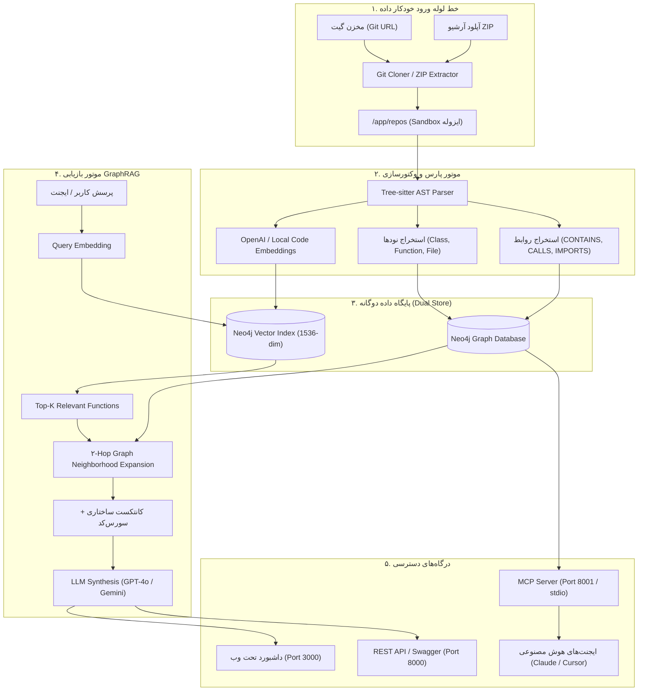

<div align="center">

# 🧠 CodeGraph Brain
### Enterprise Code Knowledge Graph, GraphRAG & Model Context Protocol (MCP) Platform

[](https://www.docker.com/)
[](https://python.org)
[](https://fastapi.tiangolo.com)
[](https://neo4j.com)
[](https://redis.io)
[](https://modelcontextprotocol.io/)

<p align="center">
  <b>تبدیل کدهای سازمانی به گراف دانش ساختاری، بازیابی هیبریدی برداری (GraphRAG) و اتصال مستقیم به ایجنت‌های هوش مصنوعی</b>
</p>

[ویژگی‌ها](#-ویژگی‌های-برجسته) •
[معماری](#-معماری-سیستم) •
[راه‌اندازی سریع](#-راه‌اندازی-سریع-با-docker) •
[داشبورد ادمین](#-داشبورد-گرافیکی-ادمین) •
[اتصال MCP به ایجنت‌ها](#-اتصال-ایجنت‌های-ai-به-mcp) •
[امنیت](#-تدابیر-امنیتی-enterprise-security) •
[راهنمای جامع](#-مستندات-بیشتر)

</div>

---

## 📖 معرفی پروژه

در سازمان‌های بزرگ، پروژه‌ها از صدها فایل، هزاران خط کد و روابط پیچیده بین سرویس‌ها تشکیل شده‌اند. مدل‌های زبانی معمولی به دلیل محدودیت پنجره کانتکست (Context Window) و عدم درک ساختار کدهای تودرتو، دچار توهم (Hallucination) می‌شوند.

**CodeGraph Brain** این چالش را با ترکیب **درخت نحو انتزاعی (AST)**، **پایگاه داده گرافی (Neo4j)** و **جستجوی برداری (Vector Embeddings)** حل کرده است:
1. سورس‌کدها اسکن شده و کلاس‌ها، متدها، فایل‌ها، ایمپورت‌ها و صدا زدن‌ها (`CALLS`) به شکل نود و یال در گراف ذخیره می‌شوند.
2. برای متن و داک‌استرینگ هر تابع وکتور ساخته می‌شود.
3. در زمان پرسش، موتور **GraphRAG** نزدیک‌ترین کدها را پیدا کرده و با پیمایش ۲ مرحله‌ای گراف (Call Graph)، زمینه کامل را برای LLM آماده می‌کند.
4. تمام این دانش از طریق پروتکل استاندارد **MCP** در اختیار دستیارهای هوش مصنوعی مانند **Claude Desktop**، **Cursor** و **Antigravity** قرار می‌گیرد.

---

## 🌟 ویژگی‌های برجسته

- ⚡ **پارس دقیق کدهای منبع (Tree-sitter):** استخراج عمیق ساختار کد بدون نیاز به اجرای آن (کلاس‌ها، توابع، داک‌استرینگ‌ها، خطوط شروع و پایان).
- 🧬 **موتور بازیابی ترکیبی (Hybrid GraphRAG):** تلفیق شباهت کسینوسی برداری (Cosine Similarity) با کوئری‌های گرافی Cypher جهت ارائه کانتکست بدون خطا به LLM.
- 🚀 **پایپ‌لاین ورود داده ۱۰۰٪ خودکار (Automated Ingestion):**
  - **کلون خودکار از گیت:** تنها با وارد کردن آدرس مخزن در گیت‌هاب/گیت‌لب (همراه با پشتیبانی از Access Token برای ریپازیتوری‌های محرمانه).
  - **آپلود مستقیم ZIP:** آپلود فایل فشرده پروژه با موتور اکسترکت امن ضد آسیب‌پذیری Zip Slip.
  - **پردازش توزیع‌شده:** اجرای وظایف سنگین در صف پس‌زمینه **Celery + Redis** با نمایش لایو درصد پیشرفت.
- 🎨 **داشبورد بصری تعاملی (Cytoscape.js):**
  - کاوش بصری در کل گراف کدهای سازمان با تفکیک رنگی نودها (ریپو، فایل، کلاس، تابع، ماژول).
  - ابزار **Node Inspector** جهت بازرسی سریع متن کد و مستندات با یک کلیک.
  - محیط چت اختصاصی **GraphRAG Search** برای سوال پرسیدن از پروژه‌ها.
- 🤖 **سرور کامل پروتکل کانتکست مدل (FastMCP Server):** ارائه ۵ ابزار کاربردی (`find_callers`, `search_code_graph`, `get_function_details`, `get_codebase_stats`, `clone_and_index_git_repository`) با دو حالت ترنسپورت `stdio` و `SSE`.
- 🔒 **ایمن‌سازی کامل سازمانی (Hardened):** احراز هویت با API Key، ساندباکس ایزوله، رمزگذاری ردیس و دیتابیس، محدودیت دوز ورودی‌ها و اجرای غیر روت.

---

## 🏗 معماری سیستم



---

## 🚀 راه‌اندازی سریع با Docker

تنها با چند دستور سامانه به همراه پایگاه داده، صف تسک‌ها، ورکر، API و داشبورد بالا می‌آید.

### ۱. تنظیم فایل متغیرها (`.env`)
فایل قالب را کپی کرده و رمزها و کلید API مد نظرتان را تنظیم کنید:

```bash
cp .env.example .env
```

محتوای نمونه در `.env`:
```env
# کلید احراز هویت برای API و داشبورد
API_KEY=MyEnterpriseKey2026!
ALLOW_UNAUTHENTICATED=false

# اطلاعات اتصال دیتابیس‌ها
NEO4J_PASSWORD=StrongNeo4jPassword2026!
REDIS_PASSWORD=StrongRedisPassword2026!

# کلید هوش مصنوعی (اختیاری جهت فعال‌سازی پاسخ‌های تحلیلی LLM)
OPENAI_API_KEY=sk-proj-xxxxxxxxxxxxxxxxxxxx
```

### ۲. اجرای کانتینرها
```bash
docker-compose up --build
```

---

## 🌐 درگاه‌های دسترسی و پورت‌ها

| سرویس | پورت | آدرس | توضیحات |
| :--- | :---: | :--- | :--- |
| **Admin Dashboard** | `3000` | [http://localhost:3000](http://localhost:3000) | پنل گرافیکی تحت وب با Cytoscape.js |
| **REST API (Swagger)** | `8000` | [http://localhost:8000/docs](http://localhost:8000/docs) | داکیومنت تعاملی و تست اندپوینت‌ها |
| **MCP Server (SSE)** | `8001` | [http://localhost:8001/sse](http://localhost:8001/sse) | پروتکل کانتکست مدل برای اتصال ریموت |
| **Neo4j Browser** | `7474` | [http://localhost:7474](http://localhost:7474) | کنسول کوئری‌نویسی مستقیم با زبان Cypher |
| **Bolt Protocol** | `7687` | `bolt://localhost:7687` | درایور اختصاصی پایگاه داده گراف |
| **Redis Broker** | `6379` | `localhost:6379` | صف وظایف پردازش پس‌زمینه کارهای سنگین |

---

## 🖥 داشبورد گرافیکی ادمین

داشبورد ادمین تحت Nginx و با فریم‌ورک سبک و مدرن طراحی شده است:
- **نوار آمار لحظه‌ای:** نمایش تعداد ریپازیتوری‌ها، فایل‌ها، کلاس‌ها، توابع و کل پیوندهای شناسایی‌شده در گراف.
- **راهنمای رنگ‌بندی نودها:**
  - 🟣 **بنفش:** ریپازیتوری ریشه (`Repository`)
  - 🔵 **آبی:** فایل‌های کد (`File`)
  - 🟡 **زرد:** کلاس‌ها (`Class`)
  - 🟢 **سبز:** توابع و متدها (`Function`)
  - 🔴 **صورتی:** ماژول‌ها و وابستگی‌های خارجی (`Module`)
- **بازرس نودها (Node Inspector):** با کلیک روی هر المان در بوم، سورس‌کد کامل آن بخش، داک‌استرینگ، و شماره خطوط در فایل ظاهر می‌شود.
- **چت GraphRAG:** پرسیدن سوالات تحلیلی در خصوص کدهای سازمان و مشاهده مستندات مرجع.

---

## 🤖 اتصال ایجنت‌های AI به MCP

این سامانه به عنوان یک سرور **Model Context Protocol** عمل می‌کند. دستیارهای هوش مصنوعی می‌توانند مستقیماً ساختار کد شما را واکشی کنند.

### ابزارهای در دسترس ایجنت:
| نام ابزار | پارامترها | عملکرد |
| :--- | :--- | :--- |
| `search_code_graph` | `query`, `repo_name`, `top_k` | جستجوی معنایی و ارائه سورس کد با وابستگی‌های فراخوانی |
| `get_function_details` | `function_name`, `repo_name` | استخراج دقیق پیاده‌سازی، کلاس والد، کالرها و کالی‌های تابع |
| `find_callers` | `function_name`, `repo_name` | **آنالیز اثر (Impact Analysis):** پیدا کردن تمام توابعی که این متد را صدا زده‌اند |
| `clone_and_index_git_repository` | `git_url`, `repo_name`, `branch` | فرمان به سیستم برای کلون و ایندکس یک ریپازیتوری جدید از گیت |
| `get_codebase_stats` | - | گزارش وضعیت و آمار کلان گراف کدهای سازمان |

### تنظیمات برای Claude Desktop یا Cursor:
فایل کانفیگ MCP ایجنت خود را باز کرده و تنظیمات زیر را وارد کنید (فایل نمونه در [`mcp_client_config.json`](mcp_client_config.json) موجود است):

```json
{
  "mcpServers": {
    "codegraph-brain": {
      "command": "docker",
      "args": [
        "exec",
        "-i",
        "graphrag_api",
        "python",
        "-m",
        "app.mcp_server",
        "--transport",
        "stdio"
      ]
    }
  }
}
```

> **اتصال با پروتکل SSE:** همچنین می‌توانید از آدرس مستقیم `http://localhost:8001/sse` برای اتصال ایجنت‌های ریموت استفاده کنید.

---

## 🔒 تدابیر امنیتی (Enterprise Security)

پروژه به طور کامل تحت ممیزی امنیتی قرار گرفته و برای استقرار در شبکه‌های حساس سازمانی مقاوم‌سازی (Harden) شده است:

1. **احراز هویت سرتاسری (API Key Auth):** تمام اندپوینت‌ها از طریق هدر `X-API-Key` محافظت می‌شوند.
2. **قرنطینه مسیرها (Anti-Path Traversal):** اسکن دایرکتوری‌ها صرفاً محدود به پوشه ساندباکس `/app/repos` بوده و دسترسی به فایل‌های سیستمی میزبان مسدود است.
3. **محافظت در برابر Zip Slip:** اکسترکت آرشیوهای آپلودشده با اعتبارسنجی کانونی مسیر انجام می‌شود.
4. **کنترل حجم و نرخ داده (Anti-DoS):** آپلود کدهای متنی تا ۱ مگابایت محدود شده و پارامترهای جستجو اعتبارسنجی می‌شوند.
5. **رمزنگاری ردیس:** فعال‌سازی فلگ اجباری `--requirepass` روی صف ردیس جهت جلوگیری از مسموم‌سازی تسک‌های Celery.
6. **ایزوله‌سازی پورت‌ها:** پورت‌های حساس تنها روی اینترفیس لوکال `127.0.0.1` بایند شده‌اند.
7. **اجرا با دسترسی غیر روت:** کانتینرهای بک‌اند تحت کاربر امن `appuser` اجرا می‌شوند.

---

## 📁 ساختار پوشه‌های پروژه

```
code-graph-brain/
├── backend/
│   ├── app/
│   │   ├── core/
│   │   │   ├── cloner.py        # موتور کلون گیت و اکسترکت امن ZIP
│   │   │   ├── embedder.py      # تولید وکتورهای معنایی (OpenAI / Local)
│   │   │   ├── graph.py         # درایور Neo4j، روابط و ایندکس برداری
│   │   │   ├── parser.py        # تحلیلگر AST با Tree-sitter
│   │   │   ├── rag.py           # موتور جستجوی هیبریدی GraphRAG
│   │   │   ├── scanner.py       # اسکنر بازگشتی پروژه‌های بزرگ
│   │   │   ├── security.py      # احراز هویت API Key و ساندباکس امنیتی
│   │   │   └── celery.py        # پیکربندی صف پیام Celery
│   │   ├── tasks/
│   │   │   └── ingestion.py     # تسک‌های غیرهمزمان کلون و ایندکس
│   │   ├── main.py              # سرور اصلی و اندپوینت‌های FastAPI
│   │   └── mcp_server.py        # سرور FastMCP برای ایجنت‌های هوش مصنوعی
│   ├── Dockerfile               # داکر ایمیج امن پایتون با کاربر appuser
│   └── requirements.txt         # وابستگی‌های بک‌اند
├── frontend/
│   ├── index.html               # رابط کاربری ادمین با Cytoscape.js و Tailwind
│   ├── nginx.conf               # کانفیگ وب‌سرور Nginx
│   └── Dockerfile               # ایمیج فوق‌سبک داشبورد
├── repos/                       # دایرکتوری ساندباکس پروژه‌ها
├── docker-compose.yml           # ارکستراسیون ۶ کانتینر اصلی
├── .env.example                 # نمونه پیکربندی متغیرهای امنیتی
├── mcp_client_config.json       # نمونه کانفیگ برای Claude و Cursor
├── USER_GUIDE.md                # کتابچه راهنمای جامع فارسی
└── README.md                    # مستندات معرفی و شروع سریع پروژه
```

---

## 📚 مستندات بیشتر

برای آموزش مرحله به مرحله، نمونه کوئری‌های زبان Cypher در دیتابیس و راهنمای سناریوهای بازبینی کد (Code Review)، فایل **[USER_GUIDE.md](USER_GUIDE.md)** را مطالعه فرمایید.

---

<div align="center">
  <sub>طراحی و توسعه یافته با ❤️ برای درک و هوشمندسازی کدهای سازمانی</sub>
</div>
