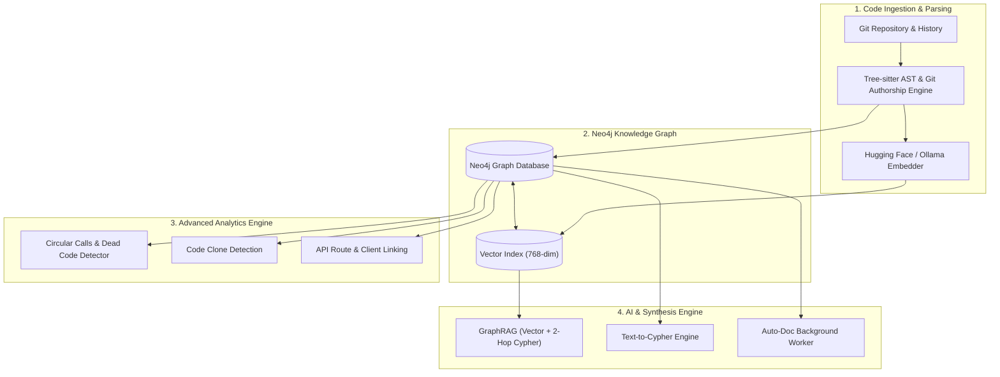

<div align="center">

# 🧠 CodeGraph Brain Enterprise
### Universal Code Knowledge Graph, Polyglot GraphRAG & AI Architectural Review Platform

[](https://www.docker.com/)
[](https://python.org)
[](https://fastapi.tiangolo.com)
[](https://neo4j.com)
[](https://redis.io)
[](https://modelcontextprotocol.io/)

<p align="center">
  <b>Transform polyglot enterprise codebases into knowledge graphs, perform hybrid vector & graph retrieval (GraphRAG), detect code clones, generate automated docstrings, audit architecture health, and integrate directly with AI coding agents (MCP).</b>
</p>

[Features](#-key-features) •
[Architecture](#-system-architecture) •
[Quick Start](#-quick-start-with-docker) •
[Enterprise Dashboard](#-enterprise-dashboard) •
[MCP Tools](#-comprehensive-mcp-tools-for-ai-agents) •
[GitHub Webhook](#-automated-github-cicd-webhook) •
[Security](#-enterprise-security) •
[User Guide](#-documentation)

</div>

---

## 📖 Overview

Enterprise codebases span millions of lines across diverse programming languages with deeply entangled dependencies. Conventional Large Language Models (LLMs) struggle with architectural reviews and refactoring because they lack full structural awareness and cross-file context, frequently hallucinating or introducing silent regression defects.

**CodeGraph Brain Enterprise** converts entire enterprise software repositories into a unified **Relational and Vector Knowledge Graph (Neo4j)** using **Abstract Syntax Trees (Tree-sitter AST)** and semantic code embeddings. The platform operates 100% locally and offline in air-gapped environments, leveraging local models (such as Hugging Face and Ollama) for embedding and LLM inference.

---

## 🌟 Key Features

### 1. Universal Polyglot Support
- Deep AST parsing with Tree-sitter and a Universal Fallback engine supporting Python, TypeScript/JavaScript, Go, Java, C/C++, C#, Rust, PHP, Ruby, Kotlin, and more.

### 2. Enterprise Intelligence & Deep Code Analytics
- 🔍 **Code Clone Detection:** Automatically identifies duplicate functions and copy-pasted logic across repositories using cosine similarity vectors.
- 🔥 **Git Hotspots & Churn Analysis:** Pinpoints files with high commit velocity (churn rate) and correlates them with structural complexity to identify bug-prone modules.
- 🔗 **Test Coverage Graph:** Automatically maps test files to core implementation functions in the graph database.
- 🌐 **Cross-Service Traceability:** Discovers backend API endpoints (e.g. `@app.get`, `router.post`) and links frontend HTTP client calls (`fetch`, `axios`) to their exact backend handlers.

### 3. Interactive AI Assistant & NL2Cypher
- 💬 **GraphRAG Chat:** Architectural queries grounded in call graphs and symbol contracts, preventing hallucinations.
- 🤖 **Text-to-Cypher (NL2Cypher):** Ask questions like: `/cypher which authentication functions call the database directly without caching?`. The AI writes and runs precise Cypher queries against Neo4j, returning verified database results.

### 4. Architectural Health & Code Smell Diagnostics
- 🔄 **Circular Dependency Chains:** Detects cyclic dependency loops (e.g. `fnA -> fnB -> fnC -> fnA`).
- ⚡ **Critical Bottlenecks & God Functions:** Identifies high fan-in/fan-out functions violating the Single Responsibility Principle.
- 👻 **Dead Code Candidates:** Identifies functions and methods with 0 inbound callers across the repository.

### 5. Blast Radius & Automated Pull Request Reviews
- Automatically analyzes Git Diffs against the knowledge graph to assess breaking change impact and calculate the blast radius up to 3 hops deep.
- 📝 **Auto-Doc Engine:** Dispatches background workers to generate standard docstrings for undocumented functions using local LLMs.

### 6. Dynamic LLM Configuration (Air-Gapped / Offline)
- **Zero Vendor Lock-in:** Easily configure your local AI endpoints (`Ollama`, `vLLM`, `LM Studio`) or enterprise models via the web dashboard with custom `Base URL`, `Model Name`, and `API Key`.

### 7. Full FastMCP Server Integration
- Built-in Model Context Protocol server over `stdio` enabling AI coding assistants (Cursor, Claude Desktop, Antigravity) to query code graphs using 11 specialized tools.

---

## 🏗 System Architecture



---

## 🛠 Quick Start with Docker

The entire platform is containerized using `docker-compose.yml`. Code embedding extraction is powered by Ollama and the code-specialized model `jina-embeddings-v2-code:latest` (based on `jina-embeddings-v2-base-code`, generating 768-dimensional embeddings).

```bash
# 1. Clone the repository
git clone https://github.com/mohamadreza1368/code_brian.git
cd code_brian

# 2. Configure environment variables
cp .env.example .env

# 3. Launch the enterprise stack
docker compose up -d --build
```

### Services Status:
- **Web Dashboard & Graph Explorer:** `http://localhost:8001`
- **Interactive OpenAPI Documentation (Swagger):** `http://localhost:8001/docs`

> **LLM Settings:** After starting, click **"LLM Settings"** in the top-right corner of the web dashboard to configure your model endpoint and provider.

---

## 📚 Documentation

For a comprehensive step-by-step user guide, architectural workflows, and sample Cypher queries, refer to **[USER_GUIDE.md](USER_GUIDE.md)**.

<div align="center">
  <sub>CodeGraph Brain Enterprise © 2026 — Built for software architects, security leads, and engineering teams.</sub>
</div>
