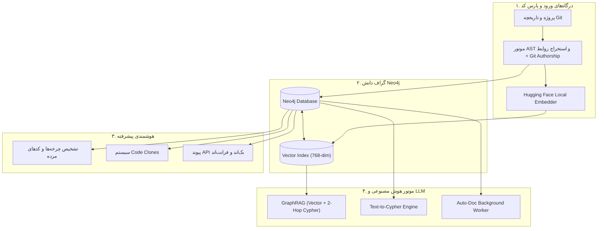

<div align="center">

# 🧠 CodeGraph Brain Enterprise
### Universal Code Knowledge Graph, Polyglot GraphRAG & AI Architectural Review Platform

[](https://www.docker.com/)
[](https://python.org)
[](https://fastapi.tiangolo.com)
[](https://neo4j.com)
[](https://redis.io)
[](https://modelcontextprotocol.io/)

<p align="center">
  <b>تبدیل کدهای سازمانی چندزبانه به گراف دانش، بازیابی هیبریدی برداری (GraphRAG)، کشف کدهای تکراری، تولید مستندات خودکار، بازبینی معماری و اتصال مستقیم به ایجنت‌های هوش مصنوعی (MCP)</b>
</p>

[ویژگی‌ها](#-ویژگی‌های-محصول-کامل) •
[معماری](#-معماری-سیستم) •
[راه‌اندازی با داکر](#-راه‌اندازی-سریع-با-docker) •
[داشبورد سازمانی](#-داشبورد-سازمانی) •
[ابزارهای MCP](#-ابزارهای-جامع-mcp-برای-ایجنت‌های-ai) •
[وب‌هوک گیت‌هاب](#-وب‌هوک-خودکار-github-cicd) •
[امنیت](#-تدابیر-امنیتی-enterprise-security) •
[راهنمای جامع](#-مستندات-بیشتر)

</div>

---

## 📖 معرفی محصول

در سازمان‌ها و شرکت‌های نرم‌افزاری، پروژه‌ها متشکل از میلیون‌ها خط کد در زبان‌های مختلف و روابط بسیار درهم‌تنیده هستند. مدل‌های زبانی متداول (LLMها) به دلیل عدم اشراف بر کل سورس‌کد و کانتکست ساختاری، هنگام ریفکتورینگ و توسعه ویژگی‌ها دچار خطاهای مهلک معماری و رگرسیون می‌شوند.

**CodeGraph Brain Enterprise** پلتفرمی کامل و همه‌جانبه است که کد سازمان شما را از طریق **درخت نحو انتزاعی (Tree-sitter AST)** به یک **گراف دانش رابطه‌ای و برداری (Neo4j)** تبدیل می‌کند. این پلتفرم کاملاً امن و ایزوله (آفلاین) کار کرده و برای ایندکس و هوش مصنوعی از شبکه‌های متن‌باز لوکال (مانند Hugging Face و Ollama) استفاده می‌کند.

---

## 🌟 ویژگی‌های محصول کامل

### ۱. پشتیبانی از تمام زبان‌های برنامه‌نویسی (Universal Polyglot)
- پارس عمیق ساختاری با Tree-sitter و موتور Universal Fallback برای پشتیبانی از Python, JS/TS, Go, Java, C/C++, C#, Rust, PHP, Ruby, Kotlin و ...

### ۲. هوش سازمانی و آنالیز عمیق (Enterprise Intelligence)
- 🔍 **تشخیص کدهای تکراری (Code Clones):** کشف خودکار توابعی که منطق کاملا مشابهی (کپی-پیست) در سراسر سیستم دارند با استفاده از Cosine Similarity.
- 🔥 **تشخیص نقاط داغ گیت (Git Hotspots):** شناسایی فایل‌هایی که دارای بیشترین تغییرات و کامیت (Churn Rate) هستند تا نقاط مستعد باگ پیدا شوند.
- 🔗 **تست کاوریج (Test Coverage Graph):** متصل کردن فایل‌های تست به منطق اصلی برنامه در دیتابیس گراف.
- 🌐 **ردیابی ارتباطات میکروسرویس‌ها (Cross-Service Traceability):** استخراج API Routeها (مانند `@app.get` و `router.post`) و اتصال خودکار فرانت‌اند (`fetch` / `axios`) به بک‌اند!

### ۳. دستیار هوشمند و تعاملی (AI Chat & NL2Cypher)
- 💬 **رابط کاربری Chat RAG:** پرسش و پاسخ تخصصی معماری، استخراج شده مستقیم از گراف وابستگی.
- 🤖 **ترجمه متن به دیتابیس (Text-to-Cypher RAG):** فقط کافیست بپرسید: `cypher/ کدام توابع احراز هویت دیتابیس را بدون کش فراخوانی می‌کنند؟`، هوش مصنوعی کد اسکریپت دقیق گراف (Cypher) را می‌نویسد و روی دیتابیس Neo4j سازمان اجرا می‌کند!

### ۴. تحلیل سلامت معماری و بوی کد (Code Smells)
- 🔄 **چرخه‌های صدا زدن دوری (Circular Call Chains):** کشف حلقه‌های `fnA -> fnB -> fnC -> fnA`.
- ⚡ **توابع پرخطر و گلوگاه‌ها (God Functions):** توابعی با فراخوانی‌های تو در تو بیش از حد.
- 👻 **کدهای مرده (Dead Code Candidates):** شناسایی توابعی بدون صدا زننده در سیستم.

### ۵. شعاع تخریب، Code Review و تولید داکیومنت
- ارزیابی خودکار Git Diff در مقایسه با گراف دانش جهت کشف توابعی که از بین خواهند رفت.
- 📝 **موتور مستندات خودکار (Auto-Doc Engine):** تولید داکیومنت (Docstrings) برای توابع فاقد مستندات در پس‌زمینه با استفاده از LLM.

### ۶. تنظیمات داینامیک LLM (پشتیبانی آفلاین)
- **بدون قفل‌شدگی روی سرویس‌دهنده خاص:** به راحتی از داشبورد گرافیکی مدل محلی خود (`Ollama`, `vLLM`, `LMStudio`) یا مدل‌های سازمانی را با تنظیم `Base URL`, `Model Name` و `API Key` متصل کنید. (پایگاه داده برداری نیز به صورت کاملا لوکال توسط `sentence-transformers` و مدل‌های Hugging Face اجرا می‌شود).

### ۷. سرور جامع FastMCP
پشتیبانی از پروتکل Model Context Protocol با درگاه `stdio` برای اتصال هوشمندانه ایجنت‌ها به گراف دانش با ۱۱ ابزار کاربردی (شامل جستجو، تحلیل معماری، تشخیص بو و ...).

---

## 🏗 معماری سیستم



---

## 🛠 راه‌اندازی سریع با Docker

تنظیمات پلتفرم در قالب کانتینرها در `docker-compose.yml` پیکربندی شده است. استخراج وکتورها و تولید Embedding از طریق سرویس Ollama و مدل مخصوص کد `jina-embeddings-v2-code:latest` انجام می‌شود. این مدل بر پایه `jina-embeddings-v2-base-code` بوده و بردارهای 768 بعدی تولید می‌کند.

```bash
# ۱. کلون پروژه
git clone https://github.com/mohamadreza1368/code_brian.git
cd code_brian

# ۲. ایجاد فایل تنظیمات محیطی
cp .env.example .env

# ۳. اجرای کامل استک سازمانی
docker compose up -d --build
```

### وضعیت سرویس‌ها:
- **داشبورد وب و مدیریت پروژه:** `http://localhost:8001`
- **مستندات تعاملی API (Swagger):** `http://localhost:8001/docs`

> **تنظیمات LLM:** بعد از اجرا، از طریق داشبورد وب (گزینه LLM Settings در بالا سمت راست) می‌توانید اتصال خود را به مدل دلخواه برقرار کنید.

---

## 📚 مستندات بیشتر

برای مطالعه راهنمای جامع گام‌به‌گام کار با سیستم، سناریوهای بازبینی کد و نمونه کوئری‌های Cypher، فایل **[USER_GUIDE.md](USER_GUIDE.md)** را مطالعه کنید.

<div align="center">
  <sub>CodeGraph Brain Enterprise © 2026 — طراحی و توسعه یافته برای هوشمندسازی و امنیت معماری نرم‌افزارهای سازمانی</sub>
</div>
