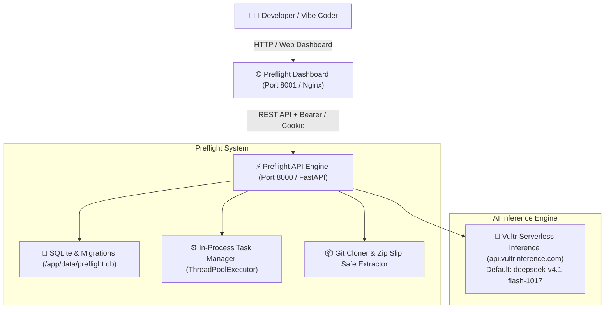

# 🚀 Preflight — Launch Readiness & Autonomous Code Quality Auditor for Apps Built with AI

[](LICENSE)
[](docker-compose.yml)
[](https://fastapi.tiangolo.com)
[](https://www.python.org/)
[](https://www.vultr.com/)
[](eval/run.mjs)

**Preflight** is an autonomous code quality gate and security auditor engineered specifically for apps created with AI coding assistants (**Cursor**, **Claude**, **Lovable**, **Bolt.new**, **v0**, **Windsurf**).

Before you ship to production, Preflight analyzes the imported repository, performs a read-only Preflight Code Review, scores code quality against an authoritative severity rubric, applies **1-click automated on-disk fixes**, and lets you **download your fixed, production-ready codebase as a ZIP archive**.

---

## 🏗️ Read-Only Review Architecture

The stack has two long-lived services (`api` and `frontend`) plus a one-shot `repo_permissions` bootstrap service. Imported repository files are reviewed; they are never installed, built, or executed by Preflight in this phase.



---

## 🌟 Key Capabilities

### 1. 🛡️ 3-Tier Preflight Auditor (13 Canonical Defects)
The auditor scans repositories against an authoritative catalog of 13 canonical defects commonly introduced by LLM code generators:

| Tier | Severity | Description & Rules Checked |
| :--- | :--- | :--- |
| 🔴 **Red (P0)** | **Critical Blocker** *(Strictly blocks shipping)* | • Leaked API keys & secrets (OpenAI, Stripe, AWS, GitHub)<br>• Unprotected administrative endpoints<br>• SQL/NoSQL injection vulnerabilities<br>• Hardcoded fallback credentials<br>• Dead primary user actions<br>• Missing critical dependencies |
| 🟠 **Orange (P1)** | **UX & Operational Hazard** *(High risk)* | • Missing loading states on async actions (prevents double-billing)<br>• Un-debounced search & filter inputs<br>• Unbounded text fields & missing input constraints<br>• Missing error boundaries on critical data routes |
| 🟡 **Yellow (P2/P3)** | **Code Hygiene & Polish** *(Maintainability)* | • Stray `console.log` / debug dump statements in production<br>• Missing route documentation / API docs<br>• Basic accessibility violations & missing labels |

- **1-Click AI Fix Prompts & Auto-Fix:** Every finding comes with a precision repair prompt ready to paste into Cursor or Lovable, plus an automated 1-click on-disk patch applicator (`/api/v1/preflight/fix-bug`).
- **Autonomous Scored Set:** Only reproducible, verified findings deduct points. Unconfirmed issues do not penalize the overall readiness score.

---

### 2. 🔎 Read-Only Preflight Code Review
Preflight's Code Review reads the imported repository and reports P0–P3 findings with actionable remediation guidance. It does not install dependencies, build the project, execute commands, launch browser automation, or create Docker containers.

- **AI-assisted review:** Uses Vultr Serverless Inference when configured.
- **Deterministic fallback:** Uses bounded static analysis when inference is unavailable.
- **No code execution:** Review operates only on the files already imported for the authenticated user.

---
Once you audit and apply automated AI fixes to your project, you can download the entire updated, production-ready codebase:
- **Download Project Button:** Positioned directly beside the *Import Project* button in the top navigation bar.
- **In-Memory Streaming:** Handled via `GET /api/v1/repos/{repo_name}/download` with zero disk overhead.
- **Clean Workspace:** Automatically excludes `.git`, `__pycache__`, `.pytest_cache`, and OS artifacts (`.DS_Store`), leaving your codebase clean and ready for deployment.

---

### 5. 🧠 Native Vultr Serverless Inference
Preflight is built natively around **Vultr Serverless Inference**:
- **Default Endpoint:** `https://api.vultrinference.com/v1`
- **Default Flagship Model:** `deepseek-v4.1-flash-1017`
- **Dynamic Catalog Discovery:** Queries `/v1/models` on startup to discover 35+ available models (`glm-5.3`, `mimo-v2.6-pro`, `qwen3.8-27b`, etc.).
- **Connection Probing:** Active connection validation checks model readiness and token latency before audits run.

---

### 6. 🔐 User Accounts & Repository Ownership
- **Account Security:** Username and Argon2id password hashing. Sessions are carried in `HttpOnly`, `SameSite=Lax` cookies with strict `X-CSRF-Token` validation.
- **Repository Isolation:** Each imported repository is owned strictly by the authenticated user and recorded in SQLite.
- **One-Time Recovery Keys:** Account recovery via unique recovery keys without unverified email dependencies.
- **Resilient SQLite:** Automatic migrations with resilient `/tmp/preflight.db` fallback if filesystem permissions are restricted.

---

## 🚀 Quick Start with Docker

### Prerequisites
- [Docker](https://docs.docker.com/get-docker/) & [Docker Compose v2](https://docs.docker.com/compose/)
- Git

### 1. Clone & Configure
```bash
git clone https://github.com/mohamadreza1368/Vultr_Hackathon.git
cd Vultr_Hackathon

# Copy sample environment configuration
cp .env.example .env
```

### 2. Configure Your Vultr Inference Key (Optional but Recommended)
Open `.env` and add your Vultr API Key:
```env
LLM_BASE_URL=https://api.vultrinference.com/v1
LLM_MODEL=deepseek-v4.1-flash-1017
LLM_API_KEY=your_vultr_api_key_here
```

### 3. Launch the Stack
```bash
docker compose up -d --build
```

`repo_permissions` runs once before the API and runner. It gives UID 1000 ownership of the bind-mounted `repos` and `data` directories so Git imports work without making them world-writable. Run the command again after updating an existing deployment.

### 4. Open the Dashboard
Navigate to **`http://localhost:8001`** (or `http://localhost:3000`) in your browser.

| Service | Port / Address | Description |
| :--- | :--- | :--- |
| **Preflight Dashboard** | `http://localhost:8001` | Full Web UI with Code Review & Code Fixer |
| **Preflight API** | `http://localhost:8000` | REST API Engine |
| **Interactive Docs** | `http://localhost:8000/docs` | Swagger / OpenAPI Explorer |
| **Health Check** | `http://localhost:8000/api/v1/health` | Service & Database Health |

---

## 📡 API Reference Overview

### Core Audit & Code Quality Endpoints
| Method | Endpoint | Description |
| :--- | :--- | :--- |
| `POST` | `/api/v1/preflight/audit` | Executes full 3-Tier Preflight Auditor (Red, Orange, Yellow). |
| `POST` | `/api/v1/preflight/fix-bug` | Applies automated on-disk fix for a reported defect. |
| `GET` | `/api/v1/review/preflight-report-download` | Generates pure Markdown audit report. |
| `POST` | `/api/v1/analyze/code` | Single snippet AST analysis and AST symbol extraction. |

### Repository Management & Export
| Method | Endpoint | Description |
| :--- | :--- | :--- |
| `GET` | `/api/v1/repos` | Lists repositories owned by the authenticated user with metrics & languages. |
| `GET` | `/api/v1/repos/{repo_name}` | Summary statistics for a specific repository. |
| `GET` | `/api/v1/repos/{repo_name}/download` | **Streams the full project codebase as a `.zip` archive.** |
| `POST` | `/api/v1/repos/{repo_name}/reindex` | Re-indexes repository with active parser. |
| `DELETE` | `/api/v1/repos/{repo_name}` | Deletes repository and cleans up disk files. |

### Ingestion & Background Tasks
| Method | Endpoint | Description |
| :--- | :--- | :--- |
| `POST` | `/api/v1/ingest/git` | Clones and indexes a remote Git repository in background. |
| `POST` | `/api/v1/ingest/upload` | Safely extracts and indexes an uploaded ZIP archive. |
| `GET` | `/api/v1/tasks/{task_id}` | Polls progress (percentage, file count, status) of background jobs. |

### Read-Only Preflight Code Review
| Method | Endpoint | Description |
| :--- | :--- | :--- |
| `POST` | `/api/v1/review/preflight-code` | Runs a read-only P0–P3 code review for an owned repository. |
| `GET` | `/api/v1/review/preflight-code/download` | Downloads the latest code-review report. |

### Authentication & Accounts
| Method | Endpoint | Description |
| :--- | :--- | :--- |
| `POST` | `/api/v1/auth/signup` | Registers new user account and returns one-time recovery key. |
| `POST` | `/api/v1/auth/login` | Authenticates user and issues `HttpOnly` session cookie. |
| `POST` | `/api/v1/auth/logout` | Revokes active session. |
| `GET` | `/api/v1/auth/me` | Returns current user details and CSRF token. |
| `POST` | `/api/v1/auth/password/forgot` | Validates username + recovery key and issues reset token. |
| `POST` | `/api/v1/auth/password/reset` | Resets password and regenerates recovery key. |

---

## 🧪 Evaluation Suite & Tests

Preflight is validated through both an automated unit test suite and an autonomous defect evaluation benchmark:

### 1. Pytest Test Suite
```bash
# Set environment and run complete test suite
pytest backend/tests/test_preflight.py \
       backend/tests/test_skills.py \
       backend/tests/test_download_project.py -v
```

### 2. Autonomous Defect Evaluation Benchmark
```bash
node eval/run.mjs
```
**Benchmark Output:**
```
=== Preflight Autonomous Evaluation Suite ===
API Base: http://localhost:8000
Registry: defects/registry.json

✔ Loaded 13 canonical defects from registry (v4.0.0).
  - 🔴 Red (P0 - Blocker): 6
  - 🟠 Orange (P1 - High Hazard): 4
  - 🟡 Yellow (P2/P3 - Maintainability): 3
✔ [PASS] Clean Repository (Zero Defects): score=100, verdict=ready
✔ [PASS] Single Red Defect (Leaked Secret): score=86, verdict=not_ready
✔ [PASS] Single Orange Defect (Double Submit): score=93, verdict=launch_with_care
✔ [PASS] Unconfirmed Findings Do Not Deduct: score=100, verdict=ready

=== Evaluation Summary ===
✔ All 4 evaluation benchmarks PASSED.
```

---

## ⚙️ Environment Configuration Reference (`.env`)

| Variable | Default | Purpose |
| :--- | :--- | :--- |
| `LLM_BASE_URL` | `https://api.vultrinference.com/v1` | Vultr Serverless Inference or OpenAI-compatible endpoint. |
| `LLM_MODEL` | `deepseek-v4.1-flash-1017` | Primary AI model ID for audits and repair prompt generation. |
| `LLM_API_KEY` | *(empty)* | API key for Vultr Serverless Inference. |
| `ALLOWED_REPO_DIR` | `/app/repos` | Isolated storage root for imported user repositories. |
| `PREFLIGHT_DB_PATH` | `/app/data/preflight.db` | SQLite database path with automatic fallback to `/tmp`. |
| `WEB_PORT` | `8001` | Exposed web dashboard HTTP port. |

---

## 📄 License

Preflight is open-source software licensed under the [MIT License](LICENSE).
