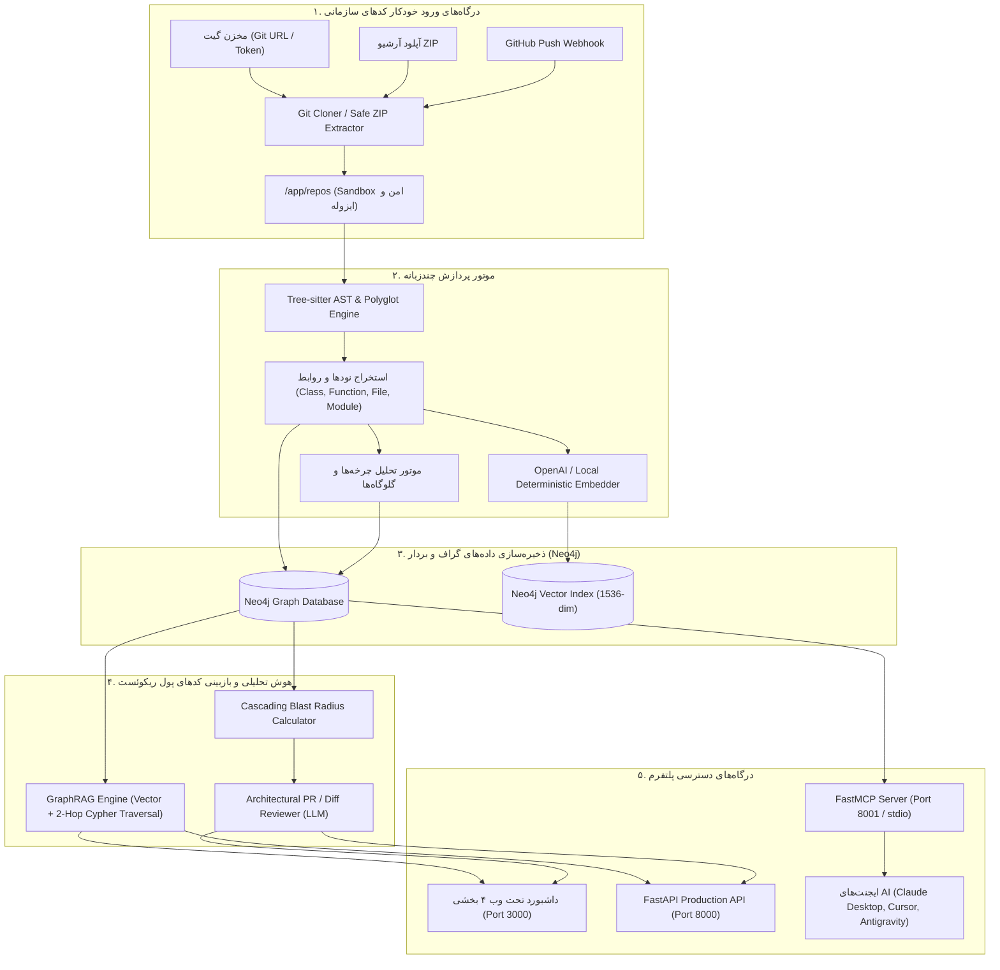

<div align="center">

# 🧠 CodeGraph Brain Enterprise
### Universal Code Knowledge Graph, Polyglot GraphRAG & AI Architectural Review Platform

[](https://www.docker.com/)
[](https://python.org)
[](https://fastapi.tiangolo.com)
[](https://neo4j.com)
[](https://redis.io)
[](https://modelcontextprotocol.io/)

<p align="center">
  <b>تبدیل کدهای سازمانی چندزبانه به گراف دانش، بازیابی هیبریدی برداری (GraphRAG)، کشف Code Smells، بازبینی معماری PR و اتصال مستقیم به ایجنت‌های هوش مصنوعی از طریق پروتکل MCP</b>
</p>

[ویژگی‌ها](#-ویژگی‌های-محصول-کامل) •
[معماری](#-معماری-سیستم) •
[راه‌اندازی با داکر](#-راه‌اندازی-سریع-با-docker) •
[داشبورد سازمانی](#-داشبورد-سازمانی-۴-بخشی) •
[ابزارهای MCP](#-ابزارهای-جامع-mcp-برای-ایجنت‌های-ai) •
[وب‌هوک گیت‌هاب](#-وب‌هوک-خودکار-github-cicd) •
[امنیت](#-تدابیر-امنیتی-enterprise-security) •
[راهنمای جامع](#-مستندات-بیشتر)

</div>

---

## 📖 معرفی محصول

در سازمان‌ها و شرکت‌های نرم‌افزاری، پروژه‌ها متشکل از میلیون‌ها خط کد در زبان‌های مختلف (Python, TypeScript, Go, Java, Rust, C++, C#) و روابط بسیار درهم‌تنیده هستند. مدل‌های زبانی متداول (LLMها) به دلیل عدم اشراف بر کل سورس‌کد و کانتکست ساختاری، هنگام ریفکتورینگ و توسعه ویژگی‌ها دچار خطاهای مهلک معماری و رگرسیون می‌شوند.

**CodeGraph Brain Enterprise** پلتفرمی کامل و همه‌جانبه است که کد سازمان شما را از طریق **درخت نحو انتزاعی (Tree-sitter AST)** به یک **گراف دانش رابطه‌ای و برداری (Neo4j)** تبدیل می‌کند. این سامانه فراتر از یک MVP بوده و ویژگی‌های درجه‌یک سازمانی زیر را ارائه می‌دهد:
- **پشتیبانی جامع چندزبانه (Polyglot Engine):** پارس عمیق زبان‌های مدرن و پشتیبانی از کلیه زبان‌های برنامه‌نویسی با موتور Universal Fallback.
- **موتور تحلیل معماری و بوی کد (Code Smells):** تشخیص چرخه‌های وابستگی دوری (Circular Dependencies)، توابع خدا (God Functions) و کدهای مرده (Dead Code).
- **محاسبه شعاع تخریب (Cascading Blast Radius):** تخمین دقیق توابع و فایل‌های تحت تاثیر قبل از ایجاد تغییرات.
- **بازبینی خودکار معماری پول ریکوئست (Automated PR Diff Review):** تحلیل دیف‌های گیت با ترکیب گراف دانش و هوش مصنوعی.
- **پایپ‌لاین خودکار با وب‌هوک CI/CD و صف توزیع‌شده Celery.**
- **سرور جامع FastMCP با ۱۰ ابزار کاربردی برای ایجنت‌های هوش مصنوعی (Claude Desktop, Cursor, Antigravity).**

---

## 🌟 ویژگی‌های محصول کامل

### ۱. پشتیبانی از تمام زبان‌های برنامه‌نویسی (Universal Polyglot)
- **پارس عمیق ساختاری با Tree-sitter:**
  - Python (`.py`)
  - JavaScript & TypeScript (`.js`, `.jsx`, `.ts`, `.tsx`)
  - Go (`.go`)
  - Java (`.java`)
  - C & C++ (`.c`, `.cc`, `.cpp`, `.h`, `.hpp`)
  - C# (`.cs`)
  - Rust (`.rs`)
- **موتور Universal Polyglot Fallback:**
  - شناسایی خودکار کلاس‌ها، توابع، ماژول‌ها و روابط در زبان‌های Ruby, PHP, Kotlin, Swift, Scala, Shell Script, SQL و ... بدون ایجاد وقفه در اسکن.

### ۲. تحلیل سلامت معماری و کشف بوی کد (Architecture Health)
- 🔄 **چرخه‌های صدا زدن دوری (Circular Call Chains):** کشف حلقه‌های `fnA -> fnB -> fnC -> fnA` که موجب نشت حافظه و باگ‌های تو در تو می‌شوند.
- ⚡ **توابع پرخطر و گلوگاه‌ها (God Functions):** توابعی با فرخوانی‌های ورودی (Inbound) یا خروجی (Outbound) نامتعارف که ریسک بالایی در ریفکتورینگ دارند.
- 👻 **شناسایی کدهای مرده (Dead Code Candidates):** شناسایی توابعی با ۰ صدا زننده در سراسر مخزن کد.

### ۳. تحلیل شعاع تخریب و بازبینی دیف گیت (Blast Radius & PR Review)
- ارزیابی خودکار Git Diff در مقایسه با گراف دانش.
- مشخص کردن لیست تمام توابع و فایل‌های تحت تاثیر تا ۳ سطح عمق.
- تخصیص رتبه ریسک (`LOW`, `MEDIUM`, `HIGH`, `CRITICAL`) به تغییرات.
- نگارش گزارش بررسی معماری توسط LLM به همراه چک‌لیست تست رگرسیون برای تیم QA.

### ۴. مدیریت چند ریپازیتوری (Multi-Repository Hub)
- مدیریت همزمان ده‌ها مخزن مجزا در یک پایگاه داده گراف دانش واحد.
- نمایش تفکیک زبان‌ها، تعداد فایل‌ها، کلاس‌ها، توابع و امکان حذف ایمن آبشاری (Cascade Detach Delete).

### ۵. پایپ‌لاین کاملاً خودکار و وب‌هوک گیت‌هاب (CI/CD Webhook)
- کلون خودکار ریپازیتوری‌های پابلیک یا پرایوت (با پشتیبانی از Personal Access Token).
- اکسترکت امن آرشیوهای ZIP با محافظت اختصاصی ضد Zip Slip.
- اندپوینت دریافت وب‌هوک گیت‌هاب (`POST /api/v1/webhooks/github`) جهت ایندکس خودکار پس از هر Push در مخازن.
- پردازش ناهمگام توزیع‌شده با صف **Celery + Redis** و پایش سلامت با اندپوینت سازمانی `/healthz`.

---

## 🏗 معماری سیستم



---

## 🖥 داشبورد سازمانی ۴ بخشی

داشبورد مدیریتی بر روی پورت `3000` در دسترس بوده و دارای ۴ نمای اصلی است:
1. 🌐 **نمای گراف و چت هوشمند (Knowledge Graph & GraphRAG):** بوم تعاملی Cytoscape با رنگ‌بندی دقیق نودها، فیلتر روی هر مخزن، بازرسی نود (کد و مستندات)، و پرسش و پاسخ معنایی متصل به LLM.
2. 📊 **نمای سلامت معماری (Architecture Health):** نمایش چرخه‌های فراخوانی، توابع حجیم و کدهای مرده به صورت کارت‌ها و جدول‌های قابل تعامل.
3. 📁 **هاب مخازن (Repositories Hub):** مدیریت لیست تمام پروژه‌های ایندکس‌شده با آمار خطوط و زبان‌ها و حذف آبشاری.
4. 🔍 **تحلیل شعاع تخریب و بررسی دیف (Diff Impact & PR Review):** امکان وارد کردن نام هر تابع جهت مشاهده نودهای وابسته یا پیست کردن Git Diff جهت تولید خودکار تحلیل معماری.

---

## 🛠 راه‌اندازی سریع با Docker

تنظیمات پلتفرم در قالب ۶ کانتینر در `docker-compose.yml` پیکربندی شده است.

```bash
# ۱. کلون پروژه
git clone https://github.com/mohamadreza1368/code_brian.git
cd code_brian

# ۲. ایجاد فایل تنظیمات محیطی
cp .env.example .env

# ۳. تنظیم کلیدها در فایل .env
# API_KEY=your-secure-enterprise-api-key
# OPENAI_API_KEY=sk-...

# ۴. اجرای کامل استک سازمانی
docker compose up -d --build
```

> [!TIP]
> **پشتیبانی از میرورهای داخلی سازمانی (IME Mirrors):**
> برای محیط‌های سازمانی بدون دسترسی مستقیم به اینترنت بین‌الملل، مقادیر `DOCKER_REGISTRY` و `PYPI_MIRROR` در فایل `.env` برای استفاده از `https://dockerhub.ime.co.ir` و `https://pypi.repo.ime.co.ir/repository/pypi-group/simple` پشتیبانی می‌شوند.


### وضعیت سرویس‌ها:
- **داشبورد مدیریتی:** `http://localhost:3000`
- **مستندات اینتراکتیو API (Swagger):** `http://localhost:8000/docs`
- **پایش سلامت سیستم:** `http://localhost:8000/healthz`
- **سرور پروتکل کانتکست مدل (MCP SSE):** `http://localhost:8001/sse`
- **محیط مدیریت دیتابیس Neo4j Browser:** `http://localhost:7474`

---

## 🤖 ابزارهای جامع MCP برای ایجنت‌های AI

پلتفرم دارای سرور کامل پروتکل کانتکست مدل (`app.mcp_server`) است که ابزارهای زیر را به ایجنت‌های هوش مصنوعی ارائه می‌دهد:

| نام ابزار MCP | توضیحات کاربردی برای ایجنت |
|---|---|
| `search_code_graph` | جستجوی معنایی هیبریدی در گراف برای یافتن توابع و کلاس‌ها به همراه کانتکست فراخوانی |
| `get_function_details` | بازیابی متن سورس کد کامل، داک‌استرینگ، و صدا زنندگان یک تابع مشخص |
| `find_callers` | رهگیری تمام توابع و فایل‌هایی که یک تابع خاص را در سراسر سازمان فراخوانی می‌کنند |
| `calculate_blast_radius` | محاسبه شعاع تخریب و وابستگی‌های آبشاری قبل از ریفکتورینگ |
| `detect_code_smells` | گزارش خودکار چرخه‌های وابستگی، توابع خدا و کدهای مرده در یک پروژه |
| `review_code_diff` | بررسی معماری تغییرات Git Diff و مشخص کردن ریسک شکست و راهنمای تست |
| `list_repositories` | ارائه لیست پروژه‌های ایندکس‌شده، تعداد فایل‌ها و زبان‌های به کار رفته |
| `index_local_repository` | ایندکس یک پوشه محلی داخل ساندباکس امن |
| `clone_and_index_git_repository` | کلون کردن و ایندکس آنی یک آدرس گیت مستقیماً توسط دستورات ایجنت |

### نمونه کانفیگ برای Claude Desktop یا Cursor:
```json
{
  "mcpServers": {
    "codegraph-brain": {
      "command": "docker",
      "args": [
        "exec",
        "-i",
        "graphrag_api",
        "python",
        "-m",
        "app.mcp_server",
        "--transport",
        "stdio"
      ]
    }
  }
}
```

---

## 🔔 وب‌هوک خودکار GitHub CI/CD

برای به‌روزرسانی آنی گراف دانش با هر کامیت در گیت‌هاب:
1. در صفحه مخزن در گیت‌هاب به مسیر **Settings > Webhooks > Add webhook** بروید.
2. آدرس Payload URL را به شکل زیر تنظیم کنید:
   ```
   https://your-domain.com/api/v1/webhooks/github
   ```
3. گزینه `Content type` را روی `application/json` بگذارید.
4. رویداد **Just the push event** را انتخاب نمایید.
سامانه به محض دریافت رویداد، تغییرات را کلون کرده و گراف دانش را به صورت خودکار بازسازی و به‌روز می‌کند.

---

## 🔒 تدابیر امنیتی (Enterprise Security)

- **احراز هویت سرتاسری:** فعال بودن بررسی `X-API-Key` بر روی تمامی اندپوینت‌های مدیریت، تحلیل و کوئری.
- **ساندباکس ایزوله و ضد Path Traversal:** دسترسی فایل‌ها در مسیر `/app/repos` محصور بوده و امکان خروج با مسیرهای نسبی وجود ندارد.
- **اکسترکت امن ضد Zip Slip:** جلوگیری از بازنویسی فایل‌های سیستمی میزبان در فایل‌های آرشیو مخرب.
- **امن‌سازی شبکه داکر:** بایند شدن پورت دیتابیس و ردیس تنها بر روی اینترفیس لوکال `127.0.0.1`.
- **رمزنگاری ردیس:** استفاده از رمز عبور اجباری در Celery برای جلوگیری از اجرای تسک‌های غیرمجاز.
- **Non-Root Execution:** اجرای فرآیندهای کانتینر بک‌اند تحت کاربر امن سیستم `appuser`.

---

## 📚 مستندات بیشتر

برای مطالعه راهنمای جامع گام‌به‌گام کار با سیستم، سناریوهای بازبینی کد و نمونه کوئری‌های Cypher، فایل **[USER_GUIDE.md](USER_GUIDE.md)** را مطالعه کنید.

---

<div align="center">
  <sub>CodeGraph Brain Enterprise © 2026 — طراحی و توسعه یافته برای هوشمندسازی و امنیت معماری نرم‌افزارهای سازمانی</sub>
</div>
